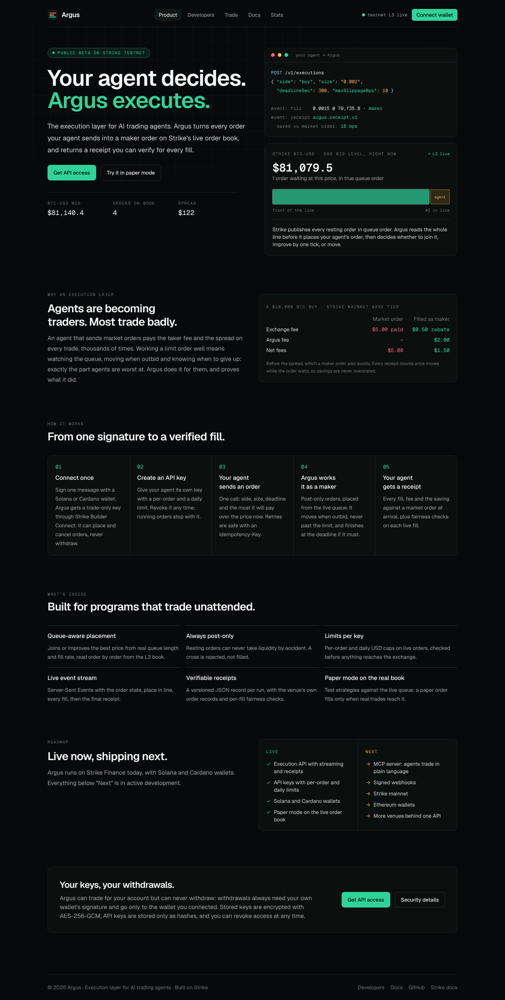
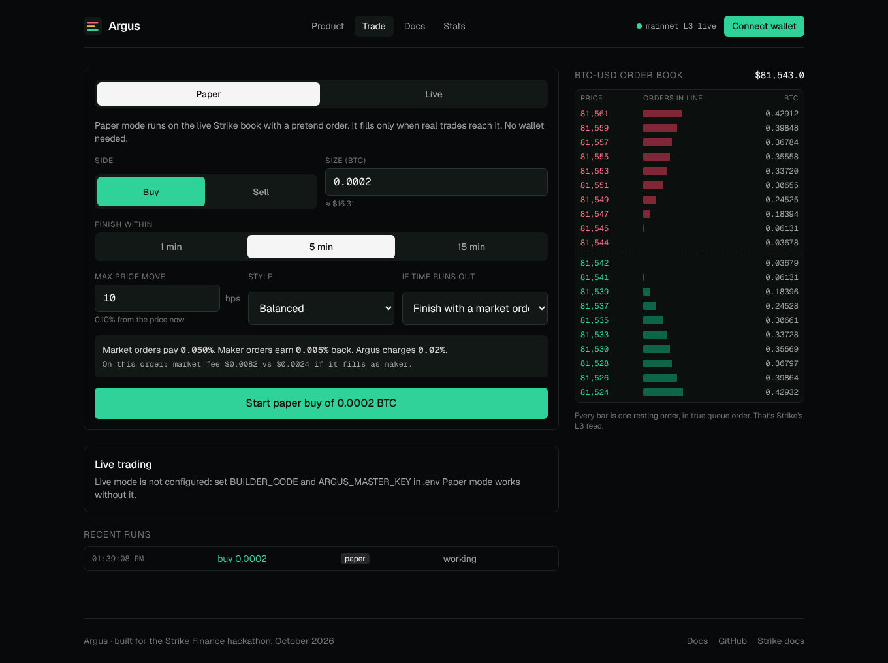
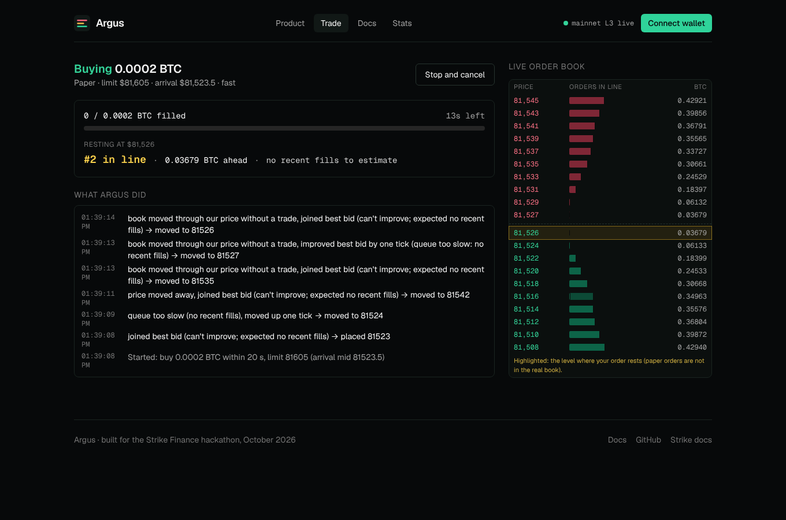
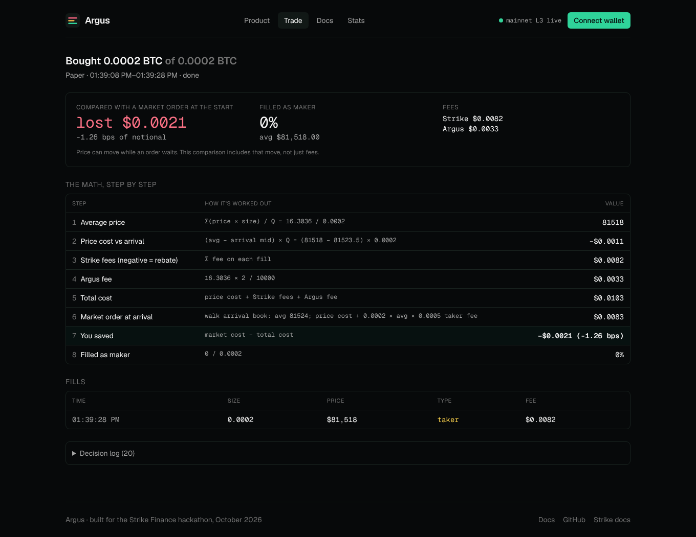
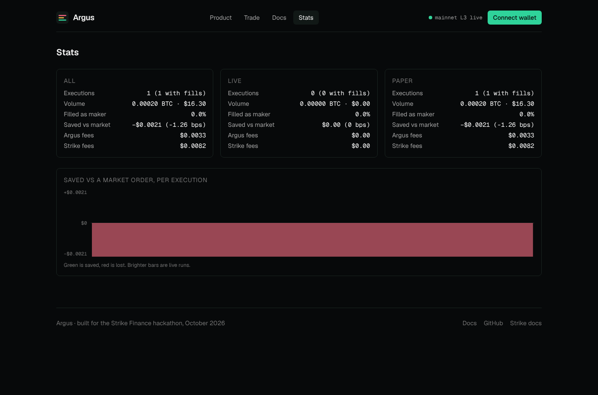

# Argus

**The execution layer for AI trading agents. Your agent decides; Argus executes.**

Argus turns every order an agent sends into a maker order on Strike's live L3 order book: it reads the queue order by order to decide where to wait, moves when outbid but never past the agent's limit, and finishes at the deadline if it must. Every run ends with a verifiable receipt, and every order carries Strike's Builder Code.

- **Live app:** https://tradeargusio.xyz (public beta on Strike testnet)
- **For developers:** https://tradeargusio.xyz/#/developers (API keys, quickstart, API reference)
- **Docs:** in the app under **Docs**, or [the source](web/src/pages/Docs.tsx)



---

## What it does

| | |
|---|---|
| **Queue-aware maker engine** | Reads Strike's L3 book order by order, joins the best bid or improves it by one tick, reprices when outbid, never past your limit |
| **Always post-only** | Resting orders can never take liquidity by accident |
| **Deadline safety net** | Finishes the rest with a market order, or cancels. If the order book is offline at the deadline, cancels instead of trading on stale data |
| **Paper mode on the real queue** | A pretend order joins the back of the live line and fills only when real trades reach it. No wallet needed |
| **Execution report** | Every number, step by step, against a market order at the moment you started |
| **Fairness receipt** | Each live fill checked: best price, first in line, on the public tape by trade ID |
| **Wallets** | Phantom (Solana) and CIP-30 Cardano wallets (Lace, Eternl, Nami) through Strike Builder Connect |
| **Deposit and withdraw** | Fund Strike and withdraw to your own wallet from inside Argus |

| Trade | Live execution |
|---|---|
|  |  |
| **Report** | **Stats** |
|  |  |

---

## The math (example)

A $10,000 BTC buy at Strike's base tier, with Argus's 2 bps fee, filled fully as maker at the arrival price:

| Step | Market order | Through Argus |
|---|---|---|
| 1. Strike fee | 10,000 × 0.0005 = **$5.00 paid** | 10,000 × (−0.00005) = **$0.50 rebate** |
| 2. Argus fee | none | 10,000 × 0.0002 = **$2.00** |
| 3. Net fees | **$5.00** | 2.00 − 0.50 = **$1.50** |
| 4. You save | | 5.00 − 1.50 = **$3.50 (3.5 bps)** |

A market order also pays the spread and walks the book. Price can also move while a maker order waits, so every report compares against a market order **at the moment you started**, including price change, not just fees.

---

## How it uses Strike

| Strike feature | How Argus uses it |
|---|---|
| L3 websocket + snapshot | Rebuilds the BTC-USD book order by order (snapshot, buffered replay, strict sequence checks) for queue position and fill speed |
| Trade stream | Fill rates and fairness checks; L3 `trade_id` equals the tape's `t` |
| Builder Connect | One-signature onboarding with a trade-only API wallet, from Phantom or any CIP-30 Cardano wallet |
| Builder Codes (`X-Builder-Fee-Bps`) | Argus's 2 bps fee on every order; each report lists the orders as Strike reports them, with their Builder code and fee |
| Orders API | Post-only limit orders, atomic replace, cancel, market with `slippage` |
| User websocket | Real fills, fees, rebates and the maker flag |
| Builder deposit and withdraw | Strike-built deposit transactions and wallet-signed withdrawals to the user's own wallet |
| Exchange info | Tick size, step size, minimum size and notional |

---

## Run it yourself

Requires Node.js 20 or newer. Works on Windows, macOS and Linux.

```powershell
git clone https://github.com/softalpha0/Argus
cd Argus
npm install
copy .env.example .env      # macOS/Linux: cp .env.example .env
npm run dev                 # http://localhost:5173
```

Paper mode works with no extra setup. Live mode needs `BUILDER_CODE` and `ARGUS_MASTER_KEY` in `.env`.

| Script | What it does |
|---|---|
| `npm run dev` | Server and web app with hot reload |
| `npm test` | Unit tests (96) |
| `npm run build` | Builds server and web |
| `npm start` | Production build on one port (`http://localhost:8080`) |

### Settings (`.env`)

| Variable | Default | Meaning |
|---|---|---|
| `STRIKE_ENV` | `mainnet` | `mainnet` or `testnet` |
| `SYMBOL` | `BTC-USD` | Market |
| `PORT` | `8080` | Server port |
| `DATA_DIR` | `./data` | Executions, reports, encrypted keys (when `DATABASE_URL` is unset) |
| `DATABASE_URL` | none | Postgres connection string. When set, all data is kept in Postgres instead of files |
| `BUILDER_CODE` | none | Your builder code, exactly as Strike stores it (mainnet `argus`, testnet `Argus` for this project) |
| `BUILDER_MAX_FEE_BPS` | `10` | Max fee users approve when connecting |
| `ARGUS_FEE_BPS` | `2` | Fee charged per order |
| `ARGUS_MASTER_KEY` | none | 32-byte hex key that encrypts stored API wallet keys |
| `TAKER_FEE` / `MAKER_FEE` | read from Strike | Pin the fees for paper mode and the baseline; unset reads Strike's base tier at startup |

### Testing live mode for free on testnet

Strike's testnet takes Cardano Preprod test ADA. Get some from the [Cardano faucet](https://docs.cardano.org/cardano-testnets/tools/faucet), deposit it on testnet.strikefinance.org from a Cardano wallet on Preprod, register your builder code there, set `STRIKE_ENV=testnet`, and connect that wallet in Argus. The testnet book is thin and its minimum order is $100, so orders mostly rest unfilled, but each one still shows your builder code and fee on Strike.

### Deploy to Render

`render.yaml` defines one web service on Render's free plan, running against Strike testnet.

1. Push this repo to GitHub.
2. In Render, choose **New → Blueprint** and pick the repo.
3. Set `BUILDER_CODE` and `ARGUS_MASTER_KEY` when prompted. Generate the key with `node -e "console.log(require('crypto').randomBytes(32).toString('hex'))"`.
4. Deploy. The app is served at the Render URL; `/healthz` returns `{"ok":true}`.

The free plan sleeps after 15 minutes without visitors (the first visit after that takes about 30 seconds) and has no disk, so run history, connected wallets and API keys reset on each restart unless you set `DATABASE_URL`. Open the site before a demo to wake it. To keep data, create a Render Postgres database and set `DATABASE_URL` on the service to its internal connection string; for an always-on server, also set `plan: starter`.

---

## API

| Endpoint | Does |
|---|---|
| `GET /api/market` | Book with every order in queue order, spread, fill rates |
| `POST /api/connect/start`, `/finish`, `/logout` | Builder Connect sign-in |
| `GET /api/me` | Connected wallet, account and balance |
| `POST /api/executions` | Starts a paper or live execution |
| `GET /api/executions`, `/api/executions/:id` | Running and recent runs; live state, queue position, fills |
| `POST /api/executions/:id/cancel` | Stops and cancels |
| `GET /api/reports/:id` | Full report with every step of the math |
| `GET /api/stats` | Totals across all executions |
| `POST /api/funds/deposit/quote`, `/build`, `/confirm` | Deposits through Strike's Builder API |
| `POST /api/funds/withdraw/quote`, `/confirm` | Withdrawals to the connected wallet |
| `WS /live` | Live market, execution, fill and report updates |
| `GET /api/keys`, `POST /api/keys`, `DELETE /api/keys/:id` | List, create and revoke API keys (signed-in session only) |

### Using Argus from a program or an AI agent (v1 API)

The `/v1` API is the stable interface for programs and agents. Sign in on the site, then create an API key; the full key is shown once and Argus stores only its hash.

```bash
# While signed in (browser session cookie):
curl -X POST https://tradeargusio.xyz/api/keys -H 'content-type: application/json' \
  -b 'argus_session_testnet=...' -d '{"name":"my bot","maxOrderUsd":500,"dailyUsd":2000}'
# -> {"key":"argus_3f9c1a2b7d4e_...","apiKey":{...}}
```

Then try [`examples/quickstart.mjs`](examples/quickstart.mjs), which starts an execution, follows it live and prints the receipt (Node 18+, no dependencies). It uses https://tradeargusio.xyz unless you set `ARGUS_URL` to your own deployment:

```bash
ARGUS_KEY=argus_... node examples/quickstart.mjs --side buy --size 0.002 --deadline 120
```

| Endpoint | Does |
|---|---|
| `POST /v1/executions` | Starts an execution. Body: `mode` (`paper`/`live`), `side`, `size`, `deadlineSec`, `maxSlippageBps`, `preset`, `fallback`, optional `clientRef` (your own reference) |
| `GET /v1/executions` | Your executions, newest first (`?limit=` up to 100) |
| `GET /v1/executions/:id` | State, filled size, working order and its place in line, time left |
| `POST /v1/executions/:id/cancel` | Stops it; safe to repeat |
| `GET /v1/executions/:id/events` | Server-Sent Events: `execution` snapshots while it runs, `fill` per fill, then the final `execution` and the `receipt`, then the stream closes |
| `GET /v1/executions/:id/receipt` | Receipt once finished (`409 not_ready` before) |

- **Retries:** send an `Idempotency-Key` header on `POST /v1/executions`. A retry with the same key and body returns the execution already started (`200`, `Idempotent-Replayed: true`) instead of placing a second order. The same key with a different body gets `409 idempotency_key_reused`. Keys are kept for 24 hours; failed requests are not kept, so they can be retried.
- **Errors** are `{"error":{"type":"...","message":"..."}}` with `type` one of `invalid_request`, `unauthorized`, `forbidden`, `limit_exceeded`, `not_found`, `conflict`, `idempotency_key_reused`, `not_ready`, `unavailable`, `server_error`.
- **Receipt** (`schema: "argus.receipt.v1"`): requested parameters, `outcome` (`filled`, `partially_filled`, `not_filled`), timing, arrival mid and limit, result (filled size, average price, maker share), costs (price versus arrival, venue fees, builder fee, total), the benchmark (a market order for the filled size at arrival, with the taker fee) and the saving in USD and bps, every fill with its liquidity, fees and fairness checks, and the venue's own order records for live runs. Amounts are decimal strings in USD.
- **Keys and limits:** a key acts for the wallet that created it and can only start, follow and stop executions; it can't deposit, withdraw, or create or change keys. Each key has a per-order limit (`maxOrderUsd`, default $500) and a daily limit (`dailyUsd`, default $2,000) on live orders, measured at the mid when the order starts. Revoking a key stops every running execution it started. A wrong or revoked key gets `401`.

---

## Security

- Argus's key for your account can trade but can't withdraw. Withdrawals always need your own wallet's signature and Strike sends them only to the wallet you connected.
- Stored keys are encrypted with AES-256-GCM, with the wallet address bound in.
- Sessions are httpOnly, SameSite=Lax cookies; only token hashes are stored. Mainnet and testnet sign-ins are separate.
- API keys are stored as SHA-256 hashes and checked in constant time. Keys are limited per order and per day, and can be revoked at any time.
- Every order is post-only unless the deadline fallback runs. At most 2 order actions per second per user.
- You can stop any execution at any time, and revoke Argus's key in Strike's app.

---

## Limits

- **BTC-USD only for now.** Strike's L3 feed currently covers one market.
- **Maker orders aren't guaranteed to fill.** When few takers trade, an order can wait the whole time and finish with the fallback. Reports show it.
- **Waiting has a cost.** Price can move while your order rests.
- L3 order IDs are public IDs. Argus links your order to its L3 entry by side, price, size and timing.

---

## What's next

1. Ethereum wallets through Builder Connect.
2. More markets as Strike enables L3 for them.
3. **Maker Vault:** a Strike vault, run by Argus, that keeps maker orders on the book and shares the rebates and spread with depositors.
4. A public API so other bots and apps can route orders through Argus.

---

## Notes on Strike's behavior

Things observed against the live API while building, beyond what the docs say:

- L3 snapshot price strings aren't normalized: the same book can contain `"82630.0"` and `"82621"`. Argus keys every level by `new Decimal(p).toString()`.
- `GET /price/v2/exchangeInfo` lists several symbols (e.g. `XAU-USD`), but L3 covers BTC-USD only.
- BTC-USD rules (Oct 21, 2026): tick `1`, step and min size `0.00001` BTC, minimum order value `$10`, market orders capped at `120` BTC. A $10 order is enough, so no leverage is needed for a demo.
- The L3 feed is busy (roughly 150 updates per second, mostly quotes being placed and pulled), but actual trades are sparse: often under one per minute. Maker orders can take a while to fill, which is why the deadline fallback matters.
- Measured on Oct 21, 2026 (around 04:00–04:25 UTC): 4 trades in one 10-minute window and **0** in another. Ten paper executions over the same period got no maker fills, and eight finished with the deadline market order. When taker flow is this thin, a maker order mostly waits and then pays the taker fee anyway. Reports show this as it is.
- L3 `trade_id` is the same number as the trade stream's `t`, so fills can be matched to the public tape by ID, not just by price and size.
- A `post_only` order that would cross is cancelled rather than filled (Strike docs, Order Types).
- From Strike's builder reference: `POST /v2/order/replace` ignores `X-Builder-Fee-Bps`, so a replaced order carries no builder fee. Argus reprices with cancel then place.
- Each fill on the user stream carries `builder_fee`, charged separately from the commission and rounded down to the cent. Live reports use it.
- Testnet charges no maker commission (and pays no rebate), but does charge the 0.05% taker fee.
- Strike rejects request timestamps from the future; Argus corrects for a fast local clock using `GET /v2/time`.

### Checking the L3 sync yourself

```powershell
cd server
npx tsx scripts/soak.ts 10
```

Two more scripts exercise paper mode on the live book:

```powershell
npx tsx scripts/paper-live.ts 10        # rests a paper bid and ask, logs queue position and fills
npx tsx scripts/paper-runs.ts           # 10 paper executions with mixed settings, prints each report
```

`soak.ts` keeps the book in sync for 10 minutes. Every minute it rebuilds a second copy from a fresh snapshot plus the recorded updates, and checks both copies match order by order. It also counts how many tape trades match an L3 `trade_id`.

---

## Built with

Node.js, TypeScript, Fastify, React, Vite, Tailwind CSS, decimal.js, @noble/ed25519, Phantom and CIP-30 wallet APIs. Data and trading through Strike Finance's API.
